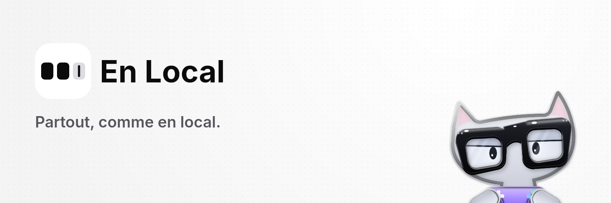

<p align="center">
  <picture>
    <source media="(prefers-color-scheme: dark)" srcset="docs/banniere-sombre.png">
    
  </picture>
</p>

<p align="center"><b>Partout, comme en local.</b><br>Quinze consoles Nintendo et PlayStation dans une seule app, à la manette comme sur une console.<br>Un code, et tes potes jouent avec toi comme sur le même canapé, où qu'ils soient.</p>

<p align="center"><a href="https://loc-lab.fr/">Site</a> · <a href="https://loc-lab.fr/rejoindre">Discord</a> · <a href="https://www.tiktok.com/@enlocal.app">TikTok</a></p>

<p align="center"><b>Prochainement.</b></p>

## Ce que c'est

En Local est une app pour Windows, pensée comme le menu d'une console et pilotable à la manette, au clavier ou à la souris.

- **Quinze consoles, une seule app** : NES, Super Nintendo, N64, Game Boy, Game Boy Color, GBA, DS, 3DS, GameCube, Wii, Wii U, Switch, PlayStation, PS2 et PS3. Les jeux se lancent dans la fenêtre d'En Local, sans émulateur ouvert à côté.
- **Sessions avec un code** : crée une session, tes amis la rejoignent avec son code ou en un clic depuis Discord. Local sans fil sur Switch, 3DS et DS, netplay sur GameCube, Wii et les anciennes consoles, sans ouvrir de port.
- **Jeu à distance** : les jeux sans mode en ligne (Mario Party…) se jouent quand même ensemble. Tes amis voient ton écran et jouent avec leur manette, jusqu'à 8.
- **Menu HOME** : en pleine partie, le jeu se met en pause et En Local s'ouvre par-dessus. Captures, clips, figurines amiibo et Skylanders, session, réglages.
- **Amis** : chacun a un code ami à 8 chiffres, lié à son compte Discord. Ajoute tes amis, vois à quoi ils jouent, rejoins-les.
- **Mii** : crée jusqu'à 100 Mii dans En Local. Ils partent tout seuls sur la 3DS, la Wii, la Wii U et la Switch.
- **Communautés** : une par jeu, avec des messages écrits ou dessinés à la main, des « Ouais ! » et des commentaires.
- **Profil** : temps de jeu par console, 104 défis, un Pokédex qui lit tes vraies sauvegardes, et le même profil sur tous tes appareils, sauvegardes comprises.
- **Tournois** : un membre organise, les autres s'inscrivent, chaque match se joue dans une session.
- **18 thèmes** : des couleurs des consoles (Game Boy, GameCube Indigo, Wii, PS2…) aux ambiances animées (Sakura, Neige, Minuit…).

## Installer

**Prochainement.** En Local n'est pas encore ouvert à tous. Abonne-toi sur [TikTok](https://www.tiktok.com/@enlocal.app) et rejoins le [serveur Discord](https://loc-lab.fr/rejoindre) pour être prévenu de la sortie.

### Ce qu'il te faut

- Windows 10 ou 11 (64 bits), et une manette de préférence.
- Un compte Discord, membre du serveur Discord d'En Local.
- Tes propres jeux : les copies de tes cartouches et de tes disques.
- Switch : les clés (`prod.keys`) et le firmware de ta console. 3DS : le `boot9.bin` de ta console pour les jeux chiffrés. PS2 et PS3 : le BIOS et le firmware officiel de Sony. En Local les range pour toi.

**En Local ne fournit aucun jeu, aucune clé, aucun firmware ni aucun BIOS.**

## Comment c'est fait

| Dossier | Contenu |
| --- | --- |
| `proto/ui` | L'interface (HTML, CSS, JavaScript), affichée par WebView2 |
| `proto/src-tauri` | L'app en Rust (Tauri 2) : lancement des émulateurs, manettes, fichiers, réglages |
| `forks` | Les modifications apportées aux émulateurs (fenêtre intégrée, sessions, manettes) |
| `outils` | Scripts de compilation, l'installeur, l'outil Pokédex (C#, PKHeX.Core) |

Les émulateurs utilisés :

- **DS** : melonDS DS (cœur libretro, chargé dans l'app)
- **3DS** : AzaharPlus (fork d'Azahar)
- **GameCube et Wii** : Dolphin
- **Wii U** : Cemu
- **Switch** : Eden
- **NES, Super Nintendo, N64, Game Boy, GBA, PlayStation et PS2** : RetroArch, avec Mesen, Snes9x, Mupen64Plus-Next, Gambatte, mGBA, PCSX ReARMed et LRPS2
- **PS3** : RPCS3

L'app parle à **Loc**, le serveur d'En Local, pour la connexion Discord, les amis, les sessions, les communautés et les mises à jour.

### Compiler

Il faut Windows, Rust, Node.js et Visual Studio (C++). Puis :

```powershell
cd proto\src-tauri
cargo build --release
```

`outils\installeur.ps1` construit l'installeur complet, avec les émulateurs (compilés à part, voir les scripts `outils\*build*.ps1` et les patchs de `forks`).

## Licence

En Local est sous licence **GPL-3.0** (voir [LICENSE](LICENSE)).

Les composants inclus gardent leur licence : Eden et melonDS (GPL-3.0), Azahar et Dolphin (GPL-2.0 ou plus), Cemu (MPL-2.0), RetroArch (GPL-3.0) et ses cœurs (chacun sa licence, dans `emu\retroarch\cores`), RPCS3 (GPL-2.0), PKHeX.Core (GPL-3.0), FFmpeg (LGPL), 7-Zip (LGPL, avec la restriction unRAR), nsz (MIT), SDL (zlib), Tauri (MIT / Apache-2.0).

Nintendo, Sony, les consoles et les jeux cités appartiennent à leurs propriétaires. En Local n'est ni affilié ni approuvé par Nintendo ou Sony.
